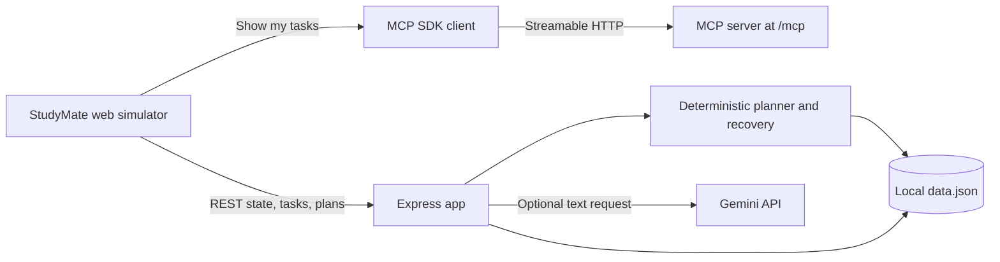

# StudyMate AI

**StudyMate AI is a personal study operations agent for students whose available time changes.** It keeps explicit study preferences and task history, detects workload conflicts when students provide effort estimates and daily availability, compares what-if plans, asks before consequential changes, and records what happened.

## Project description

StudyMate is a student-first academic planning workspace for the moments when a to-do list stops being useful: an exam is close, assignments compete, or yesterday’s session did not happen. Instead of marking everything urgent, it uses the student’s saved work to explain what fits, what must wait, and why. A missed session can be rebuilt from the last approved plan, excluding tasks already completed. The student stays in control; no task is silently completed and no deadline is moved.

## Working features

- Save assignments with priority and exact due dates; save exam dates.
- Show open work, completion state, nearest deadline, exam countdowns, and the latest approved study schedule from persisted backend data.
- Ask for a time-bounded plan in natural language, or request recovery after a missed session. The planner ranks saved tasks by deadlines and priorities, explains its reasoning, and identifies work that does not fit.
- Adjust the proposed available time and recalculate. The previous unapproved proposal is marked cancelled; the approved schedule stays unchanged until the new proposal is approved.
- Approve a proposal to persist it in the schedule and activity history, or cancel it without changing tasks.
- Start recovery directly from the saved approved session. The server excludes completed work and only carries forward open tasks linked to that session.
- Record an approved session as completed, partially completed, or not completed. Partial-session remaining minutes prefill the next recovery window; this does not automatically complete assignments.
- Compare the approved allocation with a recovery proposal, including revised minutes and work left outside the available window.
- Build what-if proposals from current saved open work, optionally prioritizing a subject that matches an open saved task. The approved schedule remains unchanged until the proposal is reviewed and approved; task, exam, preference, or source-session changes invalidate stale proposals.
- Add optional estimated effort to tasks. The Deadline Risk Radar compares explicit effort estimates to a saved daily study window and shows the arithmetic behind a conflict, including a matching saved exam date when a task has no individual due date. It reports insufficient information instead of inventing percentages.
- Save, inspect, edit, and clear explicit preferences: daily available minutes and up to five study priorities. When a request omits today's time, the assistant asks before reusing the saved daily preference.
- Create custom reminders and derive one deadline reminder per task/deadline. Edit dates, snooze, complete, or dismiss reminders; duplicate task reminders are prevented and reminder state persists in `data.json`.
- Navigate seven hash-addressed workspaces: Overview, Tasks, Study plans, Recovery, Exams, Assistant, and Activity / Integrations. Recovery offers distinct session-based recovery and current-work what-if proposals; neither changes the approved plan until explicit approval. Tasks can be filtered, reopened, or have their saved title/deadline/priority updated; assistant-driven deadline changes require confirmation.
- Inspect persisted MCP request/tool names and safe error summaries. The Activity workspace has a control that performs a real `list_tasks` call through the MCP SDK client and server.
- Use MCP tools to list/add/complete tasks, propose study plans, and list exams.
- Use reminders while the app is open. The local Express service has no background scheduler, so reminders do not deliver alerts while the application is closed.
- Use optional Gemini answers for general study questions. Task management and planning remain available if Gemini is not configured or fails.

## Architecture



- `public/` contains the responsive HTML, CSS, and JavaScript workspace.
- `server.js` contains Express routes, date and request validation, local JSON persistence, deterministic plan/recovery logic, optional Gemini calls, and the MCP server and simulator client.
- `data.json` stores tasks and explicit effort estimates, exams, proposed/approved/cancelled plans and their input snapshots, session outcomes, preferences, reminders, idempotency keys, and a bounded activity history. Writes use a temporary file and rename. If saved JSON is unreadable, startup preserves a timestamped `.corrupt-*` copy and starts an empty store with a console warning; inspect that copy before continuing if its data matters.
- Dates accept `today`, `tomorrow`, or strict `YYYY-MM-DD` in `STUDYMATE_TIMEZONE` (default `Asia/Kolkata`). Ambiguous slash-form dates are rejected.
- Proposed plans do not mutate tasks. Approval persists a plan record; completed tasks stay completed, open tasks stay open, and deadlines are not changed.
- The interface uses seven navigable hash-based workspaces with browser history, a collapsible desktop sidebar, keyboard-operable mobile drawer, native dialogs, focus-visible states, reduced-motion support, and a custom animated orbital SVG mark. A 2.2-second introduction appears once per tab session, can be skipped, and is suppressed for reduced-motion users. Activity events are written from real application/MCP operations; no execution trace is simulated.
- Task effort estimates are optional and user-entered. The planner uses an estimate as an upper bound for a focus block; it is not evidence of task completion. The radar only assesses workload fit when both effort estimates and a daily availability preference exist, and uses deterministic date-bucketed arithmetic rather than a predictive model.
- The optional Gemini integration is for open-ended answers. Local deterministic parsing handles supported study-time, task-deadline confirmation, and plan-comparison requests. Conversation bubbles and pending confirmations are session-scoped; tasks, exams, plans, outcomes, and activity are persisted.

## Alexa+ implementation path

This project implements a **self-hosted MCP server**, plus a browser simulator that uses its actual `list_tasks` tool. It is not connected to an Alexa device or Amazon partner-only add-on tooling. The installed `@modelcontextprotocol/sdk` advertises MCP protocol `2025-11-25`; the automated suite initializes an MCP client over Streamable HTTP, discovers tools, calls `list_tasks`, and verifies that the browser simulator also calls the server. The hackathon rules accept a self-hosted MCP server using at least `2025-11-25` over Streamable HTTP; verify deployment/access requirements for the submission environment in the [official rules](https://amazonappdev2026.devpost.com/rules). The canonical protocol text is the [MCP 2025-11-25 specification](https://modelcontextprotocol.io/specification/2025-11-25).

The MCP endpoint is `POST /mcp`. Tools: `list_tasks`, `add_task`, `complete_task`, `propose_study_plan`, and `list_exams`. The Activity workspace invokes `list_tasks` using the SDK client against the running Streamable HTTP server. `propose_study_plan` only creates a proposal; approval remains an explicit app action.

## Setup and configuration

Requirements: Node.js 20+ and npm.

```powershell
npm.cmd install
if (!(Test-Path .env)) { Copy-Item .env.example .env }
npm.cmd start
```

Open <http://localhost:3000>. Run tests with `npm.cmd test`. On macOS/Linux, use `npm install`, `cp .env.example .env`, `npm start`, and `npm test`. In Windows PowerShell, `npm` may resolve to a script blocked by the local execution policy; `npm.cmd` avoids that shell shim issue.

Core task planning requires no API key. For optional general AI answers, create a key in [Google AI Studio](https://aistudio.google.com/app/apikey) and set `GEMINI_API_KEY=your_key` in `.env`. Do not add the key to browser code or commit `.env`.

| Variable | Default | Purpose |
| --- | --- | --- |
| `GEMINI_API_KEY` | unset | Optional server-only Gemini credential |
| `GEMINI_MODEL` | `gemini-3.8-flash` | Gemini model name; check current [models](https://ai.google.dev/gemini-api/docs/models) and [deprecations](https://ai.google.dev/gemini-api/docs/deprecations) |
| `STUDYMATE_TIMEZONE` | `Asia/Kolkata` | Interpretation of today/tomorrow and deadline countdowns |
| `STUDYMATE_DATA_FILE` | `./data.json` | JSON data file location |
| `PORT` | `3000` | HTTP listen port |

`.env` and `.env.*` are ignored by Git; `.env.example` is explicitly allowed and contains placeholders only.

## Demo run of show (about 2 minutes)

1. Add an exam tomorrow and two matching study tasks with explicit estimates. Set a daily availability preference; show the Deadline Risk Radar evidence for an exam-linked conflict.
2. In Assistant, ask for a 60-minute plan, inspect the rationale and unscheduled work, then approve. Show that assignments remain open until explicitly marked complete.
3. In Recovery, record a partially completed session with 20 minutes left. Build a recovery proposal from that approved session, then build a 30-minute what-if alternative that prioritizes the exam subject.
4. Inspect each proposal's changed minutes and unresolved work. Approve one, then show the approved record and persisted session outcome in plan history.
5. Ask “What changed?” and inspect the saved comparison. Change a task deadline only after the assistant requests confirmation.
6. In Activity, open Developer / Integration Details and run **Call list_tasks tool**. Show actual MCP discovery/call support in the API test result and a structured response from the same saved data.

### Short submission description

When study plans fall behind, StudyMate AI helps students recover realistically. It prioritizes real saved assignments by deadline and importance, builds a time-bounded plan, explains the trade-offs, and asks the student before saving. A missed session can be rebuilt from the last approved plan. StudyMate is a self-hosted MCP-backed web simulator, not a connected Alexa device.

## Judging evidence

| Criterion | Demonstrable evidence |
| --- | --- |
| Technical implementation | SDK-backed MCP initialize, discovery, and tool calls; persisted proposals and approvals; tests for failure and recovery paths. |
| Design | Compact dark responsive workspace with direct navigation and real task, deadline, exam, schedule, recovery, plan review, and persisted activity state. |
| Potential impact | Makes deadline and time trade-offs visible to a student; impact is plausible but not measured yet. |
| Quality of idea | Rebuilds a missed session from saved approved work, keeps completed items excluded, explains why and requests approval. |

## Tests

`npm.cmd test` runs the Node test suite serially because the integration tests share a temporary JSON store. It covers the seven workspace routes and DOM references, visual tokens/mobile navigation/reduced motion, task validation/edit/reopen, explicit preference persistence and reuse confirmation, task and exam-based risk, scenario approval/stale-input validation, reminder lifecycle, corruption backups, plan/outcome persistence, source-bounded recovery, exam prioritization, Gemini fallback, MCP validation errors, and real MCP initialization/discovery/calls.

## Developer tool feedback

| Tool / API | Purpose and what worked | What could improve / onboarding | Use again? |
| --- | --- | --- | --- |
| Node.js + npm | Runs the server and built-in test runner without a build step. **Onboarding:** standard install/start flow. | The Windows PowerShell `npm` shim was blocked by execution policy; `npm.cmd` worked. Document shell-specific commands and policy behavior more clearly. | Yes |
| Express | Serves the JSON API and static workspace. **Onboarding:** familiar routes and static hosting required little setup. | REST schemas are not shared with the MCP schemas; keep route-level validation consistent. | Yes |
| MCP TypeScript SDK | Supplies the Streamable HTTP server/client and protocol lifecycle; initialize, discovery, and calls passed local tests. **Onboarding:** package examples made transport setup practical. | Lifecycle details merit an independent-client integration test (included); a concise protocol-version example would help further. | Yes |
| Zod | Declares and validates MCP tool inputs. **Onboarding:** tool schemas were direct to add. | REST routes use separate validation logic, so contracts can drift. | Yes |
| dotenv | Loads `.env` settings on the server. **Onboarding:** one import enables local configuration without a frontend build. | Missing/invalid secrets are app behavior, not dotenv behavior; the demo key remains a manual setup step. | Yes |
| Google Fonts | Loads Space Grotesk, Inter and JetBrains Mono for headings, body copy and technical metadata. **Onboarding:** standard CSS web-font include with local fallback stacks. | Typography falls back if Google Fonts is unreachable; self-hosted fonts would remove that runtime dependency. | Yes for the demo; self-host for an offline deployment |
| Google Gemini API (optional) | Server request and honest missing/invalid-key fallback paths are implemented and failure-tested. A live smoke request reached Google, which rejected the credential currently configured in this workspace; its value was not displayed. **Onboarding:** create a key in AI Studio and configure the server environment. | Replace the rejected key before demonstrating general AI answers; provider errors should remain visible without blocking deterministic planning. | Yes, as an optional capability |

No additional developer-tool friction log is included: the Windows `npm` shim issue and workaround are recorded above; no other specific integration failure was verified.

## Limitations and submission checklist

- The web app is a simulator, not an Alexa device integration. No real Alexa account or partner SDK is connected. A browser screenshot/interactive browser-console review has not been run in this environment.
- The MCP server runs locally in this project. Remote hosting, HTTPS, authentication, and a public endpoint are not configured; arrange and verify access if required for your final demo.
- Storage is a single-user local JSON file with no concurrent-write coordination or authentication. Do not expose it publicly as-is.
- Time allocations are recommendations, not calendar events or proof that an assignment is complete. Task estimates are optional and self-reported.
- Reminders are persistent in-app records only. They appear when the app is opened; no background job, browser push, or notification while closed is implemented.
- Conversational parsing is intentionally narrow and deterministic for supported task/planning actions; ambiguous task matches ask a short clarification. Conversation bubbles and unconfirmed intents are not persisted across server restarts; saved study state and plan history are.
- Voice input/output are not implemented. The text-first assistant keeps the core workflow usable without extra permissions.
- Existing `data.json` records are preserved. Two identical legacy task rows currently exist and are visibly marked as duplicate records rather than silently deleted.
- The immediate impact is reduced manual sorting and clearer trade-offs for an individual student; no learning outcome or time-saved measurement has been collected. A multi-student service would need authenticated accounts and per-student database storage before broader use.
- No public English demo video or Devpost submission is created by this repository. Record a video under three minutes using the run of show above, include the MCP simulator path, and upload it to the submission.
- Before submission: replace the currently rejected Gemini key if you plan to show AI answers, review the preserved task list, and test the hosted MCP URL if you deploy one.

No scale, user-impact statistics, or production-readiness claims are made.
