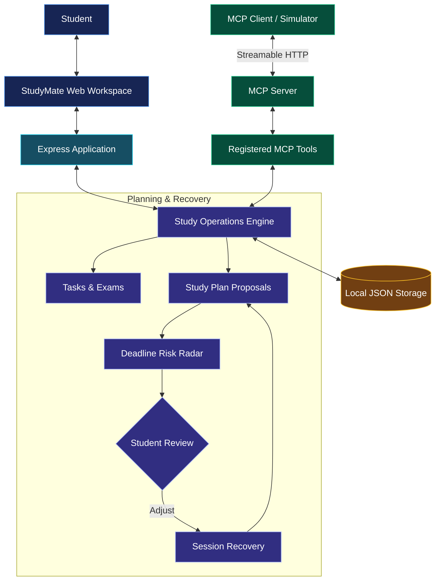

# StudyMate

### When a study plan breaks, build the next move.

StudyMate helps students organize study tasks, plan exam preparation, understand workload risks, and recover from missed study sessions.

Built for the **Amazon Developer Hackathon 2026 — Alexa+ Track**, StudyMate exposes study operations through a self-hosted Model Context Protocol (MCP) server.

> **Current status:** Planning and recovery use deterministic logic. AI/LLM integration is not currently implemented.

## Architecture



## Key Features

| Feature | Purpose |
|---|---|
| Study Planning | Proposes plans based on task estimates and available time |
| Deadline Risk Radar | Compares workload against available time |
| Session Recovery | Replans around unfinished work |
| Task & Exam Tracking | Organizes preparation |
| Persistent State | Stores application data locally |
| Student Approval | Keeps proposed changes under user control |

## Alexa+ Track: MCP Integration

**Endpoint:** `POST /mcp`

| MCP Tool | Purpose |
|---|---|
| `list_tasks` | Retrieve tasks |
| `add_task` | Add a task |
| `complete_task` | Complete a task |
| `propose_study_plan` | Propose a study plan |
| `list_exams` | Retrieve exams |

MCP lets compatible clients discover and invoke structured application tools. The project currently provides a self-hosted MCP server and web demonstration; it is not a deployed Alexa+ device integration or an Amazon-certified Agent Skill.

## Tech Stack

Node.js · Express.js · MCP SDK · Zod · dotenv · HTML/CSS/JavaScript · JSON storage

## Run Locally

**Requirements:** Node.js 20+ and npm.

```bash
git clone https://github.com/shikharxcodes/amzan_hack.git
cd amzan_hack
npm install
npm start
```

Open `http://localhost:3000` if using the default port.

Run tests:

```bash
npm test
```

## Judging Alignment

| Criterion | Project evidence |
|---|---|
| Technical Implementation | MCP tools and protocol interactions |
| Design | Organized study workspace |
| Potential Impact | Study planning and missed-session recovery |
| Quality of Idea | A student-focused workflow exposed through MCP |

These are intended areas of alignment, not guaranteed judging scores.

## Limitations & Next Steps

- No AI/LLM integration currently.
- Local JSON storage; designed for single-user use.
- No production authentication or hosted deployment.
- Future work: optional AI study assistance, multi-user storage, and additional integrations.

## Developer Tool Feedback

The submission should include honest feedback on the tools, APIs, and SDKs actually used, including the MCP SDK, Node.js, Express.js, and validation/configuration libraries.

## Judging Criteria Alignment

| Criterion | StudyMate's Strength |
|---|---|
| **Technical Implementation** | MCP server, tool discovery, structured tool calls |
| **Design** | Organized, student-friendly study workspace |
| **Potential Impact** | Practical study planning and session recovery |
| **Quality of Idea** | Combines workload analysis, planning, and recovery |

**Engineering highlights:** Modular architecture · Explainable calculations · User-approved plans · Persistent state


## License

[MIT License](LICENSE) · Copyright © 2026 Shikhar Maurya.
