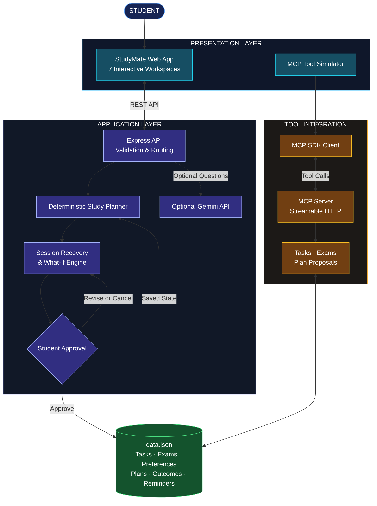

# StudyMate AI
### Plan Smarter. Recover Faster. Stay in Control.

**StudyMate AI is a personal study operations agent that helps students manage deadlines, build realistic study plans, and recover missed sessions.**

It uses saved academic data and deterministic planning to explain workload trade-offs, compare alternatives, and request approval before changing an approved plan.

## Key Features

- **Smart Study Planning:** Prioritizes saved tasks by deadlines and importance; identifies work that will not fit.
- **Session Recovery:** Rebuilds plans from approved sessions, excluding completed tasks.
- **What-If Planning:** Compares alternative study durations and subject priorities without silently changing approved plans.
- **Deadline Risk Radar:** Compares user-entered task effort estimates against available study time.
- **Exam & Task Management:** Tracks assignments, priorities, deadlines, exams, and completion status.
- **Preferences & Reminders:** Saves study preferences and manages persistent in-app reminders.
- **Approval-Based Changes:** Reviews proposed plans before approval; never silently completes assignments or moves deadlines.
- **MCP Integration:** Exposes application tools through a self-hosted MCP server, demonstrated through a browser simulator.
- **Optional AI Assistant:** Uses Gemini for general study questions; core planning works without an API key.

## Architecture



### Tech Stack

| Layer | Technology |
|---|---|
| Frontend | HTML, CSS, JavaScript |
| Backend | Node.js, Express |
| Planning | Deterministic planning and recovery logic |
| Storage | Local JSON persistence |
| AI | Optional Gemini API |
| Integration | MCP TypeScript SDK, Streamable HTTP |
| Testing | Node.js test suite |

## MCP Integration

StudyMate AI implements a **self-hosted MCP server** and a browser simulator that invokes its actual `list_tasks` tool.

**Endpoint:** `POST /mcp`

**Tools:** `list_tasks`, `add_task`, `complete_task`, `propose_study_plan`, `list_exams`.

Automated tests cover MCP initialization, tool discovery, and tool calls over Streamable HTTP.

**Scope:** This is an MCP-backed web simulator, not a connected Alexa device or an official Alexa skill. The installed SDK advertises protocol version `2025-11-25`; verify the running server's negotiated version and event requirements before claiming compliance.

References: [Hackathon Rules](https://amazonappdev2026.devpost.com/rules) · [MCP Specification](https://modelcontextprotocol.io/specification/2025-11-25)

## Getting Started

**Requirements:** Node.js 20+ and npm.

### Install

```powershell
git clone https://github.com/shikharxcodes/amzan_hack.git
cd amzan_hack
npm.cmd install
if (!(Test-Path .env)) { Copy-Item .env.example .env }
npm.cmd start
```

Open [http://localhost:3000](http://localhost:3000).

Run tests:

```powershell
npm.cmd test
```

On macOS/Linux, use `npm` instead of `npm.cmd`; create `.env` with `cp .env.example .env`.

### Configuration

| Variable | Purpose |
|---|---|
| `GEMINI_API_KEY` | Optional Gemini API key |
| `GEMINI_MODEL` | Configured Gemini model |
| `STUDYMATE_TIMEZONE` | Defaults to `Asia/Kolkata` |
| `STUDYMATE_DATA_FILE` | Defaults to `./data.json` |
| `PORT` | Defaults to `3000` |

Get an API key from [Google AI Studio](https://aistudio.google.com/app/apikey). Verify the configured model against the [Gemini model documentation](https://ai.google.dev/gemini-api/docs/models).

**Never commit `.env` or expose API keys.**

## Two-Minute Demo

1. Add an exam and study tasks with effort estimates; show the Deadline Risk Radar.
2. Request a 60-minute study plan, inspect its reasoning, and approve it.
3. Record a partially completed session and generate a recovery proposal.
4. Compare a what-if plan, inspect the trade-offs, and approve one proposal.
5. Open Activity / Integrations and run **Call `list_tasks` tool** to demonstrate MCP integration.

## Testing

Run `npm test` (Windows PowerShell: `npm.cmd test`).

Tests cover task validation, preferences, workload calculations, plan approval, stale proposals, reminders, persistence, recovery, Gemini fallback, and MCP initialization and tool calls.

## Limitations

- **Storage:** Local JSON, single-user, without concurrent-write coordination.
- **Reminders:** No background alerts while the application is closed.
- **AI:** Gemini is optional and requires valid configuration.
- **MCP deployment:** Local server; public hosting, HTTPS, and authentication are not configured.
- **Voice:** Voice input/output are not implemented.
- **Scale:** Multi-user deployment requires authenticated accounts and per-user database storage.
- **Impact:** Productivity and learning outcomes have not yet been measured.

## Future Improvements

- Multi-user database and authentication.
- More personalized study planning.
- Expanded automated tests and integrations.
- User studies to measure productivity and learning outcomes.
